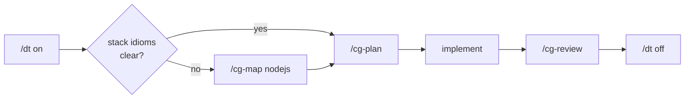

# design-thinking

AI coding agents ship code before asking what breaks. This plugin flips the
order: with `/dt` active, plans and reviews draw the call graph first — nodes
are functions, edges are data flow, every failure path is named — then code
follows that *is* the graph. Plans, reviews, and refactors render in a fixed,
mechanically checkable notation that looks the same in Go,
Rust, Python, or TypeScript.

Method by [r17x](https://github.com/r17x) ([Design Thinking
gist](https://gist.github.com/r17x/90eb2f7be93932b5693753aedb09c01a),
originally Effect-TS), generalized into this stack-agnostic Claude Code
plugin. Also available as a [pi](https://pi.dev)/OMP package —
`pi-packages/design-thinking` in this repo. Licensed MIT — see
[LICENSE](LICENSE).

## Why

A prose plan doesn't survive contact with review. An agent proposes "add
rate limiting, handle errors," the plan reads fine, and the diff either
matches it or it doesn't — prose gives no way to check which. Two failure
modes follow from that: the agent picks an unstated failure path (swallow
the error, retry silently, drop the request) nobody agreed to, or the
reviewer approves a plan that was never specific enough to catch the
mismatch once the code lands.

The graph replaces the prose plan with something that can be diffed.
Nodes are functions, edges are data and error/escape paths, boundaries are
named — fixed before code exists. `/cg-review` then reconstructs the graph
the code actually implements and diffs it against the one that was planned,
finding by finding, ending in a VERDICT. The notation is the same shape in
Go, Rust, Python, or TypeScript, so the check doesn't depend on the stack.

Skip it for a one-line fix — prose is fine there. Reach for `/dt` when the
change has a failure path worth agreeing on before it's written.

## Three methods, one shape

From r17x's gist: the same three-channel discipline, applied to three materials.

| Method | Shape | Nodes / edges | Use for |
|---|---|---|---|
| Design Thinking | `X → Graph → Effect<A, E, R>` | functions / data flow | code: plans, reviews, refactors |
| Design Graph | `Job → Flow → Surface<C, V, N>` | surfaces / the moves between them | interfaces: screens, flows, components |
| Graph Protocol | `X → Graph → Delegation<A, E, R>` | tasks / data dependencies | splitting work across subagents: AGENT SUBGRAPH in, IMPLEMENTED GRAPH out |

Plus r17x's **Meta Research Prompt Generator** (from the gist comments) as
`/research-prompt`: one topic line in, one research coordination prompt file
and the command to run it out. Its waves of research, review, index, and
synthesis agents each get an AGENT SUBGRAPH. All its files live under
`./research/` in the directory where you run it:

```
./research/
  projects/<NAME>/.<NAME>.research.prompt   the coordinator prompt
  projects/<NAME>/RESEARCH.md               the final document
  scratch/n1_<slug>.md, r1_review_<slug>.md per-node working files
  ref/INDEX.md, ref/<repo>/, ref/<file>     cloned repos and downloaded specs
```

Add `research/scratch/` and `research/ref/` to `.gitignore` if you do not want
them committed.

## Install

```bash
/plugin install design-thinking@eyay-toolkits
```

## Usage

| Command | What it does |
|---|---|
| `/dt` | Toggle Design Thinking mode. While on, plans and reviews render as annotated call graphs. Persists across restarts. |
| `/dt on\|off\|status` | Set or query the mode explicitly. |
| `/dt <prompt>` | Turn the mode **on** (never off), then run `<prompt>` under it — graph and clarifying questions first, implementation after your go-ahead. |
| `/cg <module \| task>` | Generate a call graph: extract the graph existing code implements, or sketch one for a task. |
| `/cg-plan <task>` | Design before code: full graph, then (when the task needs several workers) a Graph Protocol delegation plan with one AGENT SUBGRAPH per node, then implement and compare. |
| `/cg-review [file\|module\|diff]` | Reconstruct the implemented graph, diff it against the method's checklist, end with a VERDICT. |
| `/cg-map <language\|framework>` | Map the Design Thinking vocabulary onto a stack's idioms (Result vs exceptions, RAII vs defer). |
| `/research-prompt <topic>` | Meta Research Prompt Generator: writes `./research/projects/<NAME>/.<NAME>.research.prompt` and prints the `claude -p` / `pi -p` / `omp -p` command that runs it. Fields: `NAME:`, `REFS:`, `DEPENDS_ON:`, free-text context. |

## A real-world walkthrough

Task: *add rate limiting to an Express API.* One design pass, end to end:

```
> /dt                                        # mode on — graph-first rules injected

> /cg-plan add per-user rate limiting to the API
    → agent sketches the graph first (SHAPES, GRAPH, E, boundaries),
      then implements code that matches it

> /cg-map nodejs                             # optional: before planning, when the
    → maps ⟳↯☠🔒 onto express idioms         #   stack's vocabulary is unclear
      (middleware = boundary, AbortError = ↯escape)

> git diff → review it with:
> /cg-review src/middleware/ratelimit.ts
    → extracts the graph the code ACTUALLY implements, diffs it against
      the planned one, findings grouped by § number, ends with VERDICT

> /dt off                                    # done — back to normal mode
```

The cycle:



Skills (`design-thinking`, `design-graph`, `graph-protocol`) are loaded by the
agent on demand mid-turn — you never invoke them directly; the `/cg*`
commands and `/dt` mode tell the model when to reach for them.

## How `/dt` persists across restarts

`/dt` writes its on/off state to `.claude/design-thinking.local.md`
(`enabled: true|false`) in your project. A `SessionStart` hook reads that file
once per session and, if enabled, re-announces the mode — so it survives a
Claude Code restart without re-injecting the mode block on every single turn.

Add this to your project's `.gitignore` (it's per-user, per-project state,
not something to commit):

```gitignore
.claude/*.local.md
```
